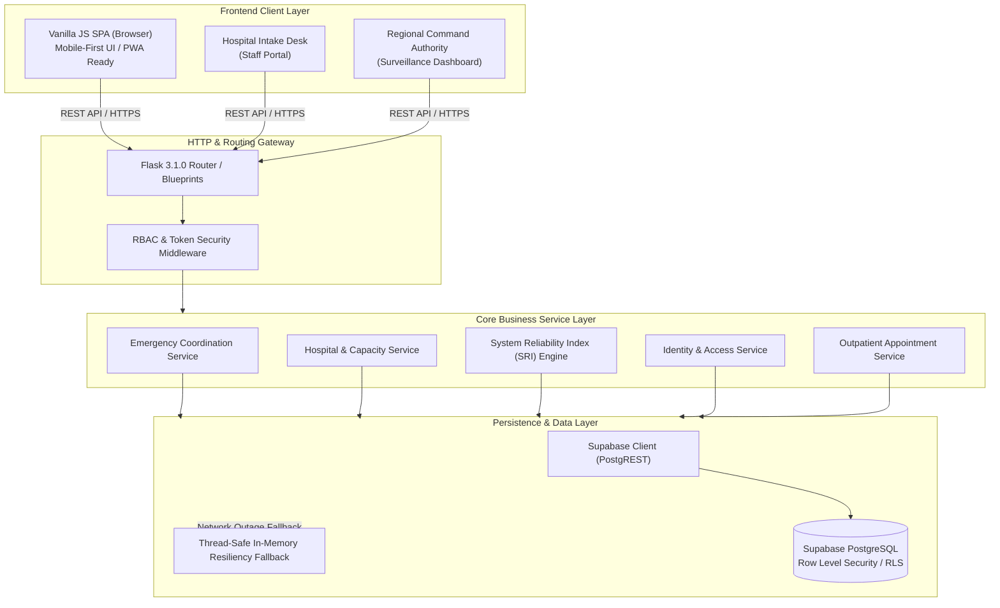
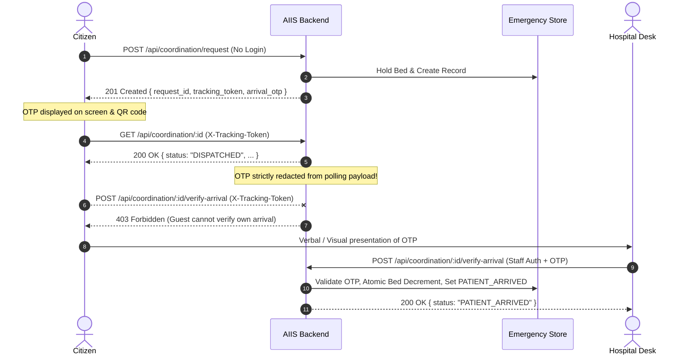

# AIIS — Technical Architecture & Integration Specification
**Project:** Arogya Integrated Information System (AIIS) Backend V2  
**Framework:** Flask 3.1.0 / Python 3.13  
**Database:** Supabase PostgreSQL (PostgREST / Row Level Security)  
**Frontend Client:** Vanilla JavaScript / HTML5 Single Page Application (Zero Build Step)  
**Date:** November 14, 2026  

---

## 1. System Architecture Overview

AIIS is architected around a layered, decoupled design that isolates presentation, business orchestration, and persistence while maintaining zero runtime friction for critical emergency paths.

---

## 2. Frontend Client Architecture

The frontend is implemented as a pure Vanilla JavaScript Single Page Application (`public/` directory) with zero build or bundler dependencies, guaranteeing instant load times on low-bandwidth mobile networks.

- **Routing:** Hash-based client router (`window.location.hash`) handling views:
  - `#/` & `#/emergency` — Citizen Emergency SOS search, hospital ranking, and dispatch.
  - `#/request/<id>` — Real-time ambulance tracking, arrival countdown, QR code display.
  - `#/hospital` — Hospital Intake Desk with live casualty queue and 1-tap OTP verification.
  - `#/authority` — Regional SRI Command Center, 36-facility monitoring, and district analytics.
  - `#/planned` — Planned outpatient care, specialty filter, and appointment booking.
  - `#/login` & `#/register` — Secure citizen and provider identity management.
  - `#/account` & `#/visits` — Patient profile and booked appointment history.
- **Central API Client (`public/app.js`):**
  - Configurable backend target: `window.AIIS_API_BASE` (defaults to `/` for unified mode).
  - Centralized header attachment: `Authorization: Bearer <token>`, `X-AIIS-Staff-Code`, `X-Tracking-Token`.
  - Envelope normalization: Handles both raw payloads and standard `{ success: true, data: { ... } }` envelopes transparently.

---

## 3. Security Architecture & Token Separation

### 3.1 Role-Based Access Control (RBAC)
AIIS enforces four distinct authorization roles:
1. `patient` — Can view and cancel only their own outpatient visits.
2. `hospital_admin` / Staff — Authorized to view and manage only their assigned facility's intake desk and capacity.
3. `authority` — Read access across regional surveillance metrics and all facilities.
4. `platform_admin` — Unrestricted system-wide maintenance access.

### 3.2 Dual-Token Emergency Security Model
To reconcile unauthenticated emergency access with zero-leakage security:

### 3.3 Arrival OTP Lifecycle & Invariant Guarantees
- **Creation Only:** The 4-digit arrival OTP is returned **exclusively** in the initial `POST /api/coordination/request` response.
- **Poll Redaction:** The OTP is completely scrubbed from all subsequent `GET /api/coordination/<id>` polling responses.
- **Staff-Only Verification:** `verify-arrival` requires authenticated hospital staff (`Authorization: Bearer <jwt>` or emergency fallback `X-AIIS-Staff-Code`). Guest tracking tokens are strictly denied with `403 Forbidden`.
- **Idempotency:** Arrival verification is strictly idempotent; repeated submissions do not trigger duplicate bed decrements.

---

## 4. Capacity Provenance & System Reliability Index (SRI)

### 4.1 Capacity Provenance Engine
AIIS guarantees truthful data labelling to prevent artificial inflation of reliability:
- `seeded_baseline` — Static baseline facility data. `verified_realtime: false`.
- `hospital_admin_reported` — Manual updates submitted via hospital administrative portal. `verified_realtime: false`.
- `iot_telemetry` — Live automated medical sensor or hardware feed. `verified_realtime: true`.

### 4.2 System Reliability Index (SRI) Algorithm
The composite SRI score ($0 - 100$) quantifies systemic hospital stress:
$$SRI = \omega_1 \cdot O_{bed} + \omega_2 \cdot O_{icu} + \omega_3 \cdot T_{wait} + \omega_4 \cdot D_{divert}$$

- **Risk Bands:**
  - `0 - 29`: **LOW** (Normal Operations)
  - `30 - 59`: **MODERATE** (Heightened Influx)
  - `60 - 79`: **HIGH** (Severe Strain / Near Capacity)
  - `80 - 100`: **CRITICAL** (Ambulance Diversion Required)

---

## 5. API Endpoint Specifications

### 5.1 Emergency & Coordination
- `POST /api/emergency/search` — Proximity search with category filtering & bed counts.
- `POST /api/coordination/request` — Dispatch emergency request; issues OTP & tracking token.
- `GET /api/coordination/<id>` — Poll tracking status with `X-Tracking-Token`.
- `POST /api/coordination/<id>/verify-arrival` — Confirm patient arrival with staff credentials & OTP.
- `POST /api/coordination/<id>/cancel` — Citizen emergency cancellation.

### 5.2 Hospital Administration & Desk
- `GET /api/hospital/<id>/requests` — Active casualty queue for hospital intake desk.
- `GET /api/hospitals/<id>/capacity` — Current bed capacity & department status.
- `POST /api/hospitals/<id>/capacity` — Update facility bed count with provenance logging.

### 5.3 Regional Authority & SRI
- `GET /api/sri/regional` — Aggregated regional stress index, zones, and district metrics.
- `GET /api/sri/hospital/<id>` — Facility-level granular SRI analysis.

### 5.4 Planned Care & Appointments
- `POST /api/planned/search` — Search outpatient clinics by specialty & distance.
- `POST /api/appointments/request` — Book outpatient consultation.
- `GET /api/appointments/me` — Authenticated patient appointment history.
- `POST /api/appointments/<id>/cancel` — Authenticated appointment cancellation.

### 5.5 Authentication & Identity
- `POST /api/auth/register` — Citizen / staff registration.
- `POST /api/auth/login` — Authentication & JWT issuance.
- `GET /api/auth/me` — Verified profile inspection.
- `POST /api/auth/logout` — Invalidate session token.

---

## 6. Verification & Automated Test Coverage

The integration is verified by 137 automated tests across 14 test suites:
- `test_auth.py` — Authentication, JWT validation, and RBAC enforcement.
- `test_database_architecture.py` — PostgreSQL schema, constraints, and RLS behavior.
- `test_emergency.py` & `test_emergency_otp_security.py` — Emergency lifecycle & OTP security.
- `test_frontend_contract.py` & `test_spa_frontend_integration.py` — SPA frontend contract verification.
- `test_stage4_part2_contracts.py` & `test_stage4_part3_contracts.py` — Capacity & SRI contract compliance.

All 137 tests pass with 100% exit code 0 across both primary and secondary development workspaces.
