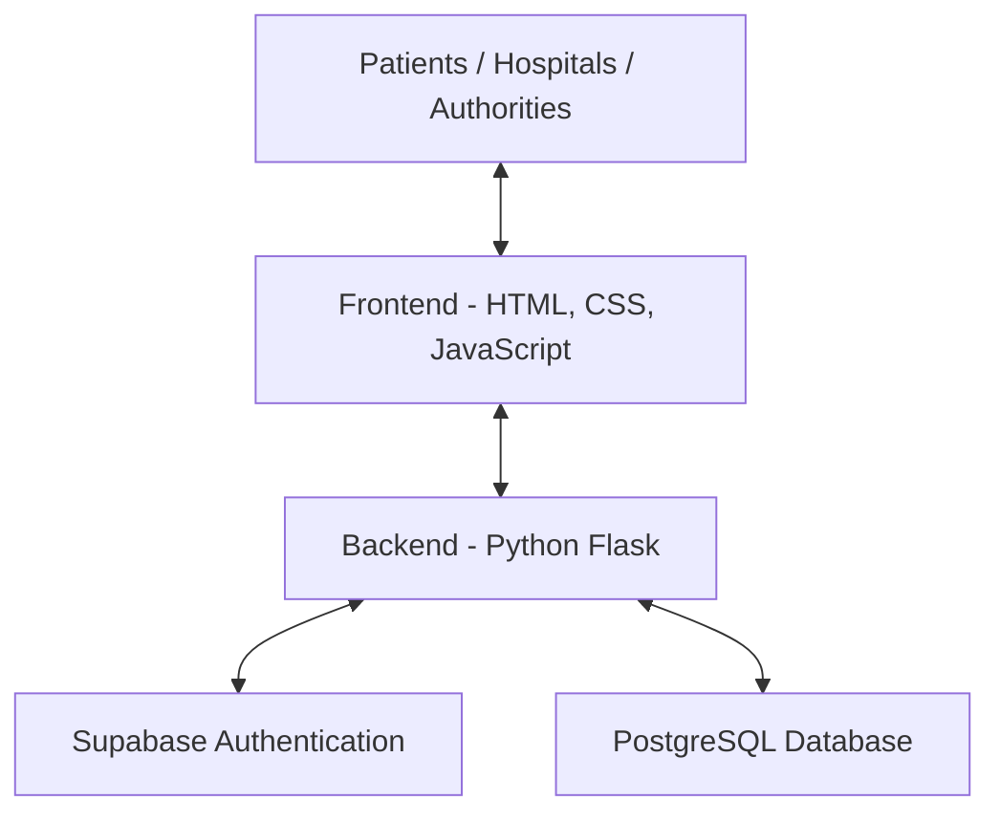

# AIIS — Arogya Infrastructure Intelligence System

### Connecting Patients, Hospitals & Healthcare Authorities

AIIS is a healthcare coordination platform designed to improve emergency hospital discovery, pre-arrival coordination and healthcare infrastructure visibility.

Built during **Colossus 3.0 – National Level Hackathon** by Team **AFTER HOURS**, AIIS focuses on addressing real-world challenges in healthcare coordination through technology.

🏆 **Achievement:** 6th Place out of 70 Teams — Best UI/UX Design Category.

---

## 🎥 Project Demo

<!-- Replace the placeholder below with your uploaded GitHub demo video link. -->

[▶ Watch AIIS Project Demo](https://drive.google.com/file/d/14t6W_6f1-HcN5KSmHlCf_WFqqQFAT91O/view?usp=drive_link)

---

## 💡 Problem Statement

During medical emergencies, patients and their families often struggle to identify suitable hospitals, understand available capacity and coordinate with healthcare facilities before arrival.

Hospitals also face challenges in communicating their readiness and managing incoming emergency requests.

AIIS aims to bridge this coordination gap by providing a unified platform connecting patients, hospitals and healthcare authorities.

## 🚀 Key Features

### 1. Emergency Hospital Discovery
- Location-based hospital discovery using geolocation.
- Emergency category selection.
- Hospital matching based on capabilities, proximity and available capacity information.
- Hospital details and relevant facility information.

### 2. Emergency Pre-arrival Coordination
- Guest-accessible emergency request submission.
- Emergency request tracking.
- Provisional bed allocation and capacity holds.
- QR-based patient arrival pass.
- OTP-based arrival verification by authorized hospital staff.

### 3. Hospital Capacity Management
- Hospital-specific staff access.
- Emergency bed and ICU capacity updates.
- Incoming emergency request management.
- Patient arrival verification.
- Capacity history and updates.

### 4. Planned Healthcare
- Hospital and specialty discovery.
- Outpatient appointment requests.
- Appointment history and request management.

### 5. Strain Risk Index (SRI)
- Healthcare infrastructure monitoring.
- Regional and hospital-level capacity insights.
- Risk classification to support infrastructure planning.

*Note: Capacity information depends on its source and freshness. Seeded or hospital-reported values should not be interpreted as independently verified real-time availability. AIIS does not guarantee hospital admission.*

---

## 🛠️ Technology Stack

| Layer | Technologies |
|---|---|
| Frontend | HTML5, CSS3, Vanilla JavaScript |
| Backend | Python, Flask |
| Database | Supabase, PostgreSQL |
| Authentication | Supabase Auth |
| API Communication | REST APIs, JSON |
| Deployment | Vercel (original frontend deployment) |

### Architecture

## ⚙️ How It Works

1. A patient accesses AIIS and selects an emergency category.
2. The application obtains the patient's location or accepts manual location input.
3. The backend identifies suitable hospitals using available hospital information.
4. The patient selects a hospital and submits an emergency request.
5. The backend stores the request and manages the applicable provisional capacity hold.
6. The patient receives tracking information and an arrival OTP.
7. Authorized hospital staff manage the incoming request and verify arrival.
8. Healthcare authorities can monitor infrastructure pressure through SRI.

---

## 🔐 Security Considerations

- JWT-based authentication for protected operations.
- Role-based access control.
- Hospital-specific authorization and isolation.
- Secure guest emergency tracking using hashed tracking credentials.
- OTP-protected arrival verification.
- Controlled database access through the backend.
- Separation of public patient workflows and protected hospital operations.

---

## 👥 Team AFTER HOURS

| Member | Role |
|---|---|
| Ashish P | Full-Stack Development Lead |
| Sushanth Hegde | Product & Project Lead |
| Affan Zoheb | AI & Predictive Analytics Lead |
| Harsha Kolli | Healthcare Workflow & UX Lead |

## 🏆 Achievement

**Colossus 3.0 — National Level Hackathon**

- Secured **6th Position out of 70 Teams** in the Best UI/UX Design category.
- Built AIIS within a 24-hour hackathon.
- Focused on creating an intuitive user experience for a real-world healthcare challenge.

---

## 🔮 Future Scope

- Integration with hospital information management systems.
- Automated hospital capacity updates.
- Verified real-time healthcare infrastructure data.
- Multilingual accessibility.
- Improved regional healthcare analytics.
- Integration with emergency response and ambulance networks.

---

## 📌 Project Information

**Project:** AIIS — Arogya Infrastructure Intelligence System

**Team:** AFTER HOURS

**Event:** Colossus 3.0 — National Level Hackathon

**Category:** Healthcare Technology

**Focus:** Emergency Coordination | Hospital Capacity Intelligence | Healthcare Infrastructure

---

### Built with purpose. Designed for impact.

Our goal is to make healthcare coordination more accessible, connected and efficient — one step at a time.

⭐ If you find this project interesting, consider giving the repository a star!
