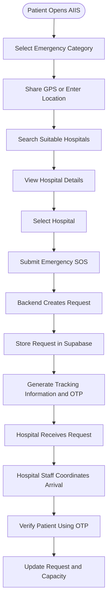
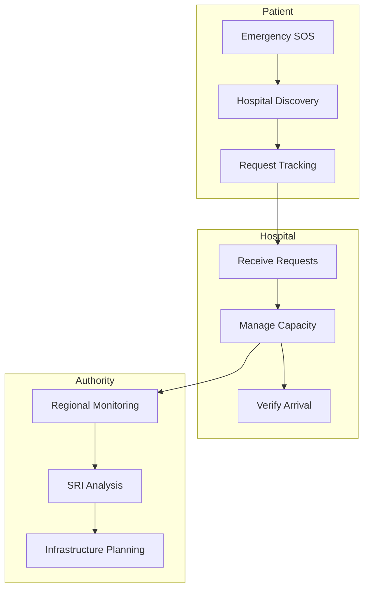
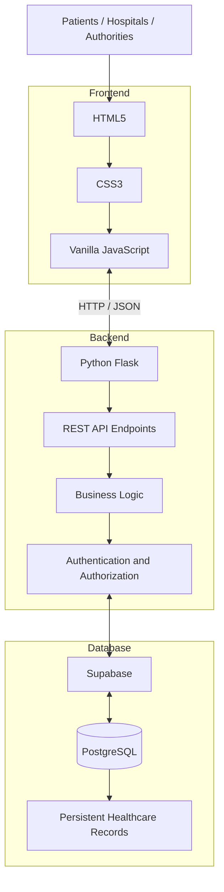

# 🏥 AIIS — Arogya Infrastructure Intelligence System

### Connecting Patients, Hospitals & Healthcare Authorities

**A smarter approach to healthcare coordination and infrastructure intelligence.**

 

**Developed by Team AFTER HOURS**

🏆 **6th Place out of 70 Teams — Best UI/UX Design Category**

---

## 📌 Table of Contents

- [About the Project](#-about-the-project)
- [The Problem](#-the-problem)
- [Our Solution](#-our-solution)
- [Project Demo](#-project-demo)
- [Key Features](#-key-features)
- [How AIIS Works](#-how-aiis-works)
- [System Architecture](#-system-architecture)
- [Technology Stack](#️-technology-stack)
- [Database Design](#-database-design)
- [Security](#-security)
- [Hackathon Achievement](#-hackathon-achievement)
- [Team AFTER HOURS](#-team-after-hours)
- [Future Scope](#-future-scope)

---

## 💡 About the Project

**AIIS (Arogya Infrastructure Intelligence System)** is a healthcare coordination platform designed to connect patients, hospitals and healthcare authorities through a unified digital ecosystem.

Developed during **Colossus 3.0 – National Level Hackathon**, AIIS addresses challenges in emergency hospital discovery, pre-arrival coordination, hospital capacity management and healthcare infrastructure monitoring.

Instead of simply helping patients locate hospitals, AIIS focuses on what happens next: understanding hospital readiness, coordinating incoming emergencies and improving visibility into healthcare infrastructure.

### 🎯 Our Mission

To make healthcare coordination more accessible, connected and efficient by bridging the information gap between patients, hospitals and healthcare authorities.

---

## 🚨 The Problem

During medical emergencies, finding the right hospital can be difficult.

Patients and their families often face challenges such as:

- Difficulty identifying hospitals with the required emergency capabilities.
- Limited visibility into available hospital capacity.
- Time-consuming communication with multiple hospitals.
- Lack of structured pre-arrival coordination.
- Limited regional visibility into healthcare infrastructure pressure.

Hospitals also need better ways to communicate readiness and coordinate incoming emergency requests.

**The challenge is not just finding a hospital. It is coordinating care before the patient arrives.**

---

## 💚 Our Solution

AIIS introduces a unified healthcare coordination system with three major stakeholders:

| Stakeholder | What AIIS Provides |
|---|---|
| 🧑‍⚕️ Patients | Emergency hospital discovery, request submission and tracking |
| 🏥 Hospitals | Incoming emergency coordination and capacity management |
| 🏛️ Healthcare Authorities | Regional infrastructure monitoring through SRI |

Our platform aims to reduce coordination gaps and help healthcare facilities make more informed operational decisions.

---

## 🎥 Project Demo

### See AIIS in Action

**Watch the complete project demonstration below.**

[**Open AIIS Demo Video**](https://drive.google.com/file/d/14t6W_6f1-HcN5KSmHlCf_WFqqQFAT91O/view?usp=drive_link)

---

## 🚀 Key Features

### 1. 🚑 Emergency Hospital Discovery

Helps patients identify suitable hospitals based on emergency requirements and location.

- GPS-based location detection.
- Manual location selection.
- Emergency category selection.
- Hospital matching based on capabilities and proximity.
- Hospital details and facility information.
- Capacity information where available.

### 2. 📍 Emergency Pre-arrival Coordination

Enables structured communication between patients and hospitals before arrival.

- Guest-accessible emergency request submission.
- Emergency request tracking.
- Provisional bed allocation and capacity holds.
- QR-based patient arrival pass.
- OTP-based arrival verification by authorized hospital staff.
- Emergency request lifecycle management.

### 3. 🏥 Hospital Capacity Management

Provides hospital staff with tools to manage and communicate facility readiness.

- Hospital-specific staff access.
- Emergency bed and ICU capacity updates.
- Incoming emergency request management.
- Patient arrival verification.
- Capacity history and updates.

### 4. 🩺 Planned Healthcare

Supports patients looking for routine healthcare services.

- Hospital discovery.
- Specialty and department search.
- Outpatient appointment requests.
- Appointment history.
- Request management and cancellation.

### 5. 📊 Strain Risk Index (SRI)

Provides infrastructure-level insights to support healthcare planning.

- Regional healthcare infrastructure monitoring.
- Hospital-level capacity insights.
- Infrastructure strain classification.
- Risk indicators for resource planning.
- Regional visibility into healthcare readiness.

**Important:** Capacity information depends on its source and freshness. Seeded or hospital-reported values are not independently verified real-time availability. SRI supports infrastructure planning and does not determine whether a hospital should receive an emergency patient. AIIS does not guarantee hospital admission.

---

## ⚙️ How AIIS Works

### Emergency Workflow

The following flow illustrates how an emergency request moves through AIIS.

### Stakeholder Workflow

---

## 🏗️ System Architecture

AIIS follows a frontend-backend-database architecture.

### Architecture Overview

1. **Frontend:** Handles user interactions, navigation, hospital discovery and dashboards.
2. **Backend:** Processes API requests, executes business logic, validates access and coordinates emergency workflows.
3. **Database:** Stores hospital information, capacity records, emergency requests, appointment information and lifecycle events.
4. **Authentication:** Protects hospital operations and other restricted functionality.

---

## 🛠️ Technology Stack

| Layer | Technology | Purpose |
|---|---|---|
| Frontend | HTML5 | Application structure |
| Styling | CSS3 | Responsive interface and visual design |
| Frontend Logic | Vanilla JavaScript | Application interactions and API communication |
| Backend | Python | Server-side programming |
| Backend Framework | Flask | REST APIs and business logic |
| Database | Supabase PostgreSQL | Relational data storage |
| Authentication | Supabase Auth | User authentication |
| Communication | REST APIs, JSON | Frontend-backend communication |
| Hosting | Vercel | Original frontend deployment |

### Why This Stack?

- **Vanilla JavaScript:** Lightweight frontend with minimal dependencies.
- **Python and Flask:** Flexible backend development and API management.
- **Supabase:** Managed PostgreSQL database and authentication capabilities.
- **REST APIs:** Structured communication between frontend and backend.

---

## 🗄️ Database Design

AIIS uses Supabase powered by PostgreSQL to manage structured healthcare information.

Some of the core database entities include:

| Table | Responsibility |
|---|---|
| `profiles` | User profiles, roles and hospital assignments |
| `hospitals` | Hospital information and location |
| `hospital_capacity` | Current capacity information |
| `hospital_capacity_history` | Historical capacity records |
| `hospital_capabilities` | Emergency and medical capabilities |
| `hospital_departments` | Hospital departments |
| `hospital_equipment` | Equipment information |
| `emergency_requests` | Emergency request records |
| `emergency_request_events` | Emergency lifecycle history |
| `hospital_request_responses` | Hospital responses to requests |
| `appointments` | Planned-care appointment requests |

### Data Persistence

Emergency requests, lifecycle events, capacity updates and appointment records are managed through the backend and stored in the database.

This allows the application to maintain records beyond an individual browser session.

---

## 🔐 Security & Access Control

Security is an important part of emergency coordination.

AIIS incorporates:

- **JWT Authentication:** Protects restricted API operations.
- **Role-Based Access Control:** Separates patient, hospital and authority permissions.
- **Hospital Isolation:** Hospital staff can only manage their authorized hospital.
- **Secure Guest Tracking:** Tracking credentials are hashed before server-side storage.
- **OTP Verification:** Supports authorized patient arrival verification.
- **Backend Authorization:** Sensitive operations are validated on the server rather than trusting frontend input.

---

## 🏆 Hackathon Achievement

### Colossus 3.0 — National Level Hackathon

### Recognized among 70 participating teams

**24 Hours. One Healthcare Challenge. One Team.**

AIIS was developed during a 24-hour hackathon by Team AFTER HOURS.

Our team focused on translating a real-world healthcare problem into an intuitive and functional digital experience.

The recognition in the Best UI/UX Design category reflects our emphasis on usability, workflow simplicity and user-centered design.

---

## 👥 Meet Team AFTER HOURS

| Team Member | Role |
|---|---|
| **Ashish P** | Full-Stack Development Lead |
| **Sushanth Hegde** | Product & Project Lead |
| **Affan Zoheb** | AI & Predictive Analytics Lead |
| **Harsha Kolli** | Healthcare Workflow & UX Lead |

**Built through collaboration, continuous iteration and shared problem-solving.**

---

## 🔮 Future Scope

AIIS has several opportunities for further development:

- Integration with existing Hospital Information Management Systems (HIMS).
- Automated and verified hospital capacity updates.
- Integration with ambulance and emergency response networks.
- Multilingual accessibility for wider adoption.
- Improved regional healthcare analytics.
- More reliable healthcare infrastructure forecasting using validated data.
- Wider integration with healthcare providers.

---

## 📌 Project Information

| Detail | Information |
|---|---|
| Project Name | AIIS |
| Full Name | Arogya Infrastructure Intelligence System |
| Team | AFTER HOURS |
| Hackathon | Colossus 3.0 |
| Event Type | National Level Hackathon |
| Duration | 24 Hours |
| Category | Healthcare Technology |
| Achievement | 6th Place — Best UI/UX Design |
| Team Size | 4 Members |

---

## 💚 Built with Purpose. Designed for Impact.

**Making healthcare coordination more accessible, connected and efficient.**

If you find AIIS interesting, consider giving this repository a ⭐!

**Team AFTER HOURS**

